English | [中文](https://github.com/seriaati/seriaati/blob/main/README_ZH.md)

# Support My Work

If you've found any of my open-source projects helpful, I'd be delighted if you considered expressing your gratitude by making a donation.

Your support not only fuels my passion for coding but also helps sustain my journey as a student and developer.

Sponsors get perks across all my projects, [more info here](https://sponsor.seria.moe).

# About Me

👋 Hi, I'm Seria, an international student from Taiwan, currently studying in Waseda University.  
❤️ I'm also a passionate developer who loves to make open source and high quality software with Python.  
🌍 I speak Chinese and English.  

## Contact Information

You can find me in the following places:  

- [Discord](https://discord.com/users/410036441129943050)
- [Email](mailto:hi@seria.moe)
- [LINE](https://line.me/ti/p/O4Y5UUJSqK)

# Recent Status

## Recent Contributions

- [seriaati/spinner-bot](https://github.com/seriaati/spinner-bot) (`today`)
- [seriaati/hoyo-buddy](https://github.com/seriaati/hoyo-buddy) - A feature-rich, easy to use, beautifully designed Discord bot made for Hoyoverse gamers (`today`)
- [seriaati/hb-data](https://github.com/seriaati/hb-data) - Package for getting data that Hoyo Buddy needs (`1 day ago`)
- [seriaati/keni](https://github.com/seriaati/keni) - Open-source AI personal finance tracker (`1 day ago`)
- [seriaati/genshin.py](https://github.com/seriaati/genshin.py) - API wrapper for HoYoLAB/Miyoushe API built on asyncio and pydantic. (`1 day ago`)

## Recent Stars

- [seriaati/kanso](https://github.com/seriaati/kanso) - A calm, open-source email client for reaching inbox zero (`1 week ago`)
- [elie222/inbox-zero](https://github.com/elie222/inbox-zero) - The world's best AI personal assistant for email. Open source app to help you reach inbox zero fast. (`1 week ago`)
- [seriaati/mochi](https://github.com/seriaati/mochi) - A small personal dashboard for managing freelance work (`2 weeks ago`)
- [Senkin219/GI-Character-Spine](https://github.com/Senkin219/GI-Character-Spine) - Spine models of Genshin Impact characters made by miHoYo/HoYoverse (`2 weeks ago`)
- [ai-job-search-dev/ai-job-search](https://github.com/ai-job-search-dev/ai-job-search) - The job search that runs on your machine. AI job application framework built on Claude Code: evaluate postings, tailor CVs, write cover letters, prep interviews. Fork it and own it. (`3 weeks ago`)

## Recent PRs

- [docs(release-notes): add v1.18.0 static animated card fix](https://github.com/seriaati/hoyo-buddy-wiki/pull/179) on [seriaati/hoyo-buddy-wiki](https://github.com/seriaati/hoyo-buddy-wiki) (`5 days ago`)
- [docs(release-notes): add v1.18.0](https://github.com/seriaati/hoyo-buddy-wiki/pull/178) on [seriaati/hoyo-buddy-wiki](https://github.com/seriaati/hoyo-buddy-wiki) (`5 days ago`)
- [docs(release-notes): add Discord notification sentence](https://github.com/seriaati/hoyo-buddy-wiki/pull/177) on [seriaati/hoyo-buddy-wiki](https://github.com/seriaati/hoyo-buddy-wiki) (`6 days ago`)
- [feat(profile): add substat breakdown strip to build cards](https://github.com/seriaati/hoyo-buddy/pull/667) on [seriaati/hoyo-buddy](https://github.com/seriaati/hoyo-buddy) (`1 week ago`)
- [feat(logging): structure logs and group Sentry log events by call site](https://github.com/seriaati/hoyo-buddy/pull/666) on [seriaati/hoyo-buddy](https://github.com/seriaati/hoyo-buddy) (`1 week ago`)

# My Projects

- 📋 [Curated list of projects](https://projects.seria.moe)
- 📊 [Uptime and maintenance status](https://status.seria.moe)

# Some Stats

  

