English | [中文](https://github.com/seriaati/seriaati/blob/main/README_ZH.md)

# Support My Work

If you've found any of my open-source projects helpful, I'd be delighted if you considered expressing your gratitude by making a donation.

Your support not only fuels my passion for coding but also helps sustain my journey as a student and developer.

Sponsors get perks across all my projects, [more info here](https://sponsor.seria.moe).

# About Me

👋 Hi, I'm Seria, an international student from Taiwan, currently studying in Waseda University.  
❤️ I'm also a passionate developer who loves to make open source and high quality software with Python.  
🌍 I speak Chinese and English.  

## Contact Information

You can find me in the following places:  

- [Discord](https://discord.com/users/410036441129943050)
- [Email](mailto:hi@seria.moe)
- [LINE](https://line.me/ti/p/O4Y5UUJSqK)

# Recent Status

## Recent Contributions

- [seriaati/hadal](https://github.com/seriaati/hadal) - Web game where rarer answers take you deeper into the sea (`today`)
- [seriaati/embed-fixer-site](https://github.com/seriaati/embed-fixer-site) - Official website for Embed Fixer. (`today`)
- [seriaati/hoyo-buddy](https://github.com/seriaati/hoyo-buddy) - A feature-rich, easy to use, beautifully designed Discord bot made for Hoyoverse gamers (`today`)
- [seriaati/cte2-db](https://github.com/seriaati/cte2-db) - Fan-made database site for the Minecraft modpack Craft to Exile 2 (`1 day ago`)
- [seriaati/hb-app](https://github.com/seriaati/hb-app) - Hoyo Buddy's web app. (`1 day ago`)

## Recent Stars

- [seriaati/hadal](https://github.com/seriaati/hadal) - Web game where rarer answers take you deeper into the sea (`1 day ago`)
- [seriaati/cte2-db](https://github.com/seriaati/cte2-db) - Fan-made database site for the Minecraft modpack Craft to Exile 2 (`3 days ago`)
- [seriaati/kanso](https://github.com/seriaati/kanso) - A calm, open-source email client for reaching inbox zero (`2 weeks ago`)
- [seriaati/mochi](https://github.com/seriaati/mochi) - A small personal dashboard for managing freelance work (`3 weeks ago`)
- [Senkin219/GI-Character-Spine](https://github.com/Senkin219/GI-Character-Spine) - Spine models of Genshin Impact characters made by miHoYo/HoYoverse (`4 weeks ago`)

## Recent PRs

- [docs(release-notes): add v1.18.0 static animated card fix](https://github.com/seriaati/hoyo-buddy-wiki/pull/179) on [seriaati/hoyo-buddy-wiki](https://github.com/seriaati/hoyo-buddy-wiki) (`2 weeks ago`)
- [docs(release-notes): add v1.18.0](https://github.com/seriaati/hoyo-buddy-wiki/pull/178) on [seriaati/hoyo-buddy-wiki](https://github.com/seriaati/hoyo-buddy-wiki) (`2 weeks ago`)
- [docs(release-notes): add Discord notification sentence](https://github.com/seriaati/hoyo-buddy-wiki/pull/177) on [seriaati/hoyo-buddy-wiki](https://github.com/seriaati/hoyo-buddy-wiki) (`2 weeks ago`)
- [feat(profile): add substat breakdown strip to build cards](https://github.com/seriaati/hoyo-buddy/pull/667) on [seriaati/hoyo-buddy](https://github.com/seriaati/hoyo-buddy) (`2 weeks ago`)
- [feat(logging): structure logs and group Sentry log events by call site](https://github.com/seriaati/hoyo-buddy/pull/666) on [seriaati/hoyo-buddy](https://github.com/seriaati/hoyo-buddy) (`2 weeks ago`)

# My Projects

- 📋 [Curated list of projects](https://projects.seria.moe)
- 📊 [Uptime and maintenance status](https://status.seria.moe)

# Some Stats

  

