[English](https://github.com/seriaati/seriaati/blob/main/README.md) | 中文

# 支持我

如果我的開源項目對你有所幫助，能收到你的捐款將讓我十分高興（並感謝）。

你的支持不僅激勵了我對程式設計的熱情，還將幫助我繼續作為一名學生和開發者的旅程。

贊助者能在我的不同項目內獲得贊助者專屬功能及好處，[了解更多](https://sponsor.seria.moe/zh-tw/)。

# 關於我

👋 你好，我是 Seria，一名來自台灣的國際學生，目前在早稻田大學進修。  
❤️ 我同時也是一位充滿熱情的開發者，熱愛使用 Python 開發開源且高品質的軟體。  
🌍 我會說中文和英文。

## 聯絡我

你可以在下列地方找到我:  

- [Discord](https://discord.com/users/410036441129943050)
- [Email](mailto:hi@seria.moe)
- [LINE](https://line.me/ti/p/O4Y5UUJSqK)

# 近況

## 近期貢獻

- [seriaati/hadal](https://github.com/seriaati/hadal) - Web game where rarer answers take you deeper into the sea (`today`)
- [seriaati/seria-bot](https://github.com/seriaati/seria-bot) - Discord bot for Seria's Discord server (`1 day ago`)
- [seriaati/keni](https://github.com/seriaati/keni) - Open-source AI personal finance tracker (`1 day ago`)
- [seriaati/embed-fixer](https://github.com/seriaati/embed-fixer) - Feature-rich Discord bot for fixing social media embeds (`1 day ago`)
- [seriaati/seria-api](https://github.com/seriaati/seria-api) - API for Seria's projects to connect to. (`1 day ago`)

## 近期 Stars

- [seriaati/hadal](https://github.com/seriaati/hadal) - Web game where rarer answers take you deeper into the sea (`1 week ago`)
- [seriaati/cte2-db](https://github.com/seriaati/cte2-db) - Fan-made database site for the Minecraft modpack Craft to Exile 2 (`1 week ago`)
- [seriaati/kanso](https://github.com/seriaati/kanso) - A calm, open-source email client for reaching inbox zero (`3 weeks ago`)
- [seriaati/mochi](https://github.com/seriaati/mochi) - A small personal dashboard for managing freelance work (`1 month ago`)
- [Senkin219/GI-Character-Spine](https://github.com/Senkin219/GI-Character-Spine) - Spine models of Genshin Impact characters made by miHoYo/HoYoverse (`1 month ago`)

## 近期 PR

- [docs(release-notes): add v1.19.0](https://github.com/seriaati/hoyo-buddy-wiki/pull/180) on [seriaati/hoyo-buddy-wiki](https://github.com/seriaati/hoyo-buddy-wiki) (`5 days ago`)
- [docs(release-notes): add v1.18.0 static animated card fix](https://github.com/seriaati/hoyo-buddy-wiki/pull/179) on [seriaati/hoyo-buddy-wiki](https://github.com/seriaati/hoyo-buddy-wiki) (`3 weeks ago`)
- [docs(release-notes): add v1.18.0](https://github.com/seriaati/hoyo-buddy-wiki/pull/178) on [seriaati/hoyo-buddy-wiki](https://github.com/seriaati/hoyo-buddy-wiki) (`3 weeks ago`)
- [docs(release-notes): add Discord notification sentence](https://github.com/seriaati/hoyo-buddy-wiki/pull/177) on [seriaati/hoyo-buddy-wiki](https://github.com/seriaati/hoyo-buddy-wiki) (`3 weeks ago`)
- [feat(profile): add substat breakdown strip to build cards](https://github.com/seriaati/hoyo-buddy/pull/667) on [seriaati/hoyo-buddy](https://github.com/seriaati/hoyo-buddy) (`3 weeks ago`)

# 我的專案

- 📋 [精心整理過的專案列表](https://projects.seria.moe)
- 📊 [運行狀態與維護資訊](https://status.seria.moe)

# 一些統計數據

  

