[English](https://github.com/seriaati/seriaati/blob/main/README.md) | 中文

# 支持我

如果我的開源項目對你有所幫助，能收到你的捐款將讓我十分高興（並感謝）。

你的支持不僅激勵了我對程式設計的熱情，還將幫助我繼續作為一名學生和開發者的旅程。

贊助者能在我的不同項目內獲得贊助者專屬功能及好處，[了解更多](https://sponsor.seria.moe/zh-tw/)。

# 關於我

👋 你好，我是 Seria，一名來自台灣的國際學生，目前在早稻田大學進修。  
❤️ 我同時也是一位充滿熱情的開發者，熱愛使用 Python 開發開源且高品質的軟體。  
🌍 我會說中文和英文。

## 聯絡我

你可以在下列地方找到我:  

- [Discord](https://discord.com/users/410036441129943050)
- [Email](mailto:hi@seria.moe)
- [LINE](https://line.me/ti/p/O4Y5UUJSqK)

# 近況

## 近期貢獻

- [seriaati/mochi](https://github.com/seriaati/mochi) - A small personal dashboard for managing freelance work (`today`)
- [seriaati/hb-data](https://github.com/seriaati/hb-data) - Package for getting data that Hoyo Buddy needs (`today`)
- [seriaati/hoyo-buddy](https://github.com/seriaati/hoyo-buddy) - A feature-rich, easy to use, beautifully designed Discord bot made for Hoyoverse gamers (`today`)
- [seriaati/embed-fixer](https://github.com/seriaati/embed-fixer) - Feature-rich Discord bot for fixing social media embeds (`today`)
- [seriaati/hoyo-buddy-wiki](https://github.com/seriaati/hoyo-buddy-wiki) - Hoyo Buddy documentation (`today`)

## 近期 Stars

- [seriaati/mochi](https://github.com/seriaati/mochi) - A small personal dashboard for managing freelance work (`1 day ago`)
- [Senkin219/GI-Character-Spine](https://github.com/Senkin219/GI-Character-Spine) - Spine models of Genshin Impact characters made by miHoYo/HoYoverse (`5 days ago`)
- [ai-job-search-dev/ai-job-search](https://github.com/ai-job-search-dev/ai-job-search) - The job search that runs on your machine. AI job application framework built on Claude Code: evaluate postings, tailor CVs, write cover letters, prep interviews. Fork it and own it. (`1 week ago`)
- [talwat/lowfi](https://github.com/talwat/lowfi) - An extremely simple lofi player. (`2 weeks ago`)
- [seriaati/box-com-downloader](https://github.com/seriaati/box-com-downloader) - Download protected files from box.com (`3 weeks ago`)

## 近期 PR

- [fix(redirects): redirect mixed-case and zh-Hant/zh-Hans docs URLs](https://github.com/seriaati/hoyo-buddy-wiki/pull/175) on [seriaati/hoyo-buddy-wiki](https://github.com/seriaati/hoyo-buddy-wiki) (`today`)
- [docs: add sponsor perks and update Features page](https://github.com/seriaati/hoyo-buddy-wiki/pull/174) on [seriaati/hoyo-buddy-wiki](https://github.com/seriaati/hoyo-buddy-wiki) (`2 days ago`)
- [fix(docs): fix 404s from relative page links](https://github.com/seriaati/hoyo-buddy-wiki/pull/173) on [seriaati/hoyo-buddy-wiki](https://github.com/seriaati/hoyo-buddy-wiki) (`2 days ago`)
- [fix(docs): fix 404 links on the homepage](https://github.com/seriaati/hoyo-buddy-wiki/pull/172) on [seriaati/hoyo-buddy-wiki](https://github.com/seriaati/hoyo-buddy-wiki) (`2 days ago`)
- [docs(changelog): add v1.17.0 release notes](https://github.com/seriaati/hoyo-buddy-wiki/pull/171) on [seriaati/hoyo-buddy-wiki](https://github.com/seriaati/hoyo-buddy-wiki) (`3 days ago`)

# 我的專案

- 📋 [精心整理過的專案列表](https://projects.seria.moe)
- 📊 [運行狀態與維護資訊](https://status.seria.moe)

# 一些統計數據

  

